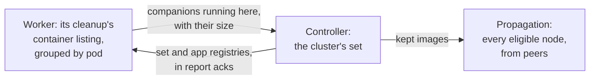

# Companion images

Most app pods run more than the app: a php-fpm exporter, an nginx in front,
a log shipper, a proxy. These **companion images** are small, shared by many
workloads, and rarely change. Without help, each one lands on a node only when
a pod using it is scheduled there, and goes again an hour after that pod
leaves. The next pod on that node then waits for it to be pulled again, just
like the app image.

Angry Duck finds companion images by itself, puts them on every node, and
keeps them there.

## Which images

A companion image is any image a pod runs **beside an app image**: an image
from one of the **app registries**. App images themselves are left to
[preheat](preheat.md) and [propagation](propagation.md).

The app registries are, unless `COMPANION_APP_REGISTRIES` names them:

- every registry CI has preheated from (the webhook), and
- every registry in the credentials file (`REGISTRY_CREDENTIALS_PATH`),
  except public ones (Docker Hub, `ghcr.io`, `quay.io`, `gcr.io`,
  `registry.k8s.io`, `mcr.microsoft.com`, `public.ecr.aws`), whose credentials
  usually exist only to lift rate limits.

The credentials file is what makes the list known right after a controller
restart, before CI calls the webhook again. Set `COMPANION_APP_REGISTRIES`
when your app images live in a registry Angry Duck has no credentials for, or
when a private registry also hosts the sidecars.

Nothing is configured per workload: a new sidecar is picked up the minute a
pod runs it, and one no pod runs anymore stops being a companion.

## How it works

1. **Each worker** already lists the node's containers every
   `GC_INTERVAL_S` for its cleanup. The listing says which containers share a
   pod, so finding companions costs no extra call: in every pod running an
   app image, the other images are companions. The worker asks containerd
   for each new one's size once, and reports them with its inventory.
2. **The controller** combines the reports into the cluster's set. Images
   above `COMPANION_MAX_MB` (300) aren't kept, nor, while a cap is set, those
   whose size no node reported yet. The set and the app registries go back
   to every worker in its report ack, only when they changed.
3. **Propagation** puts each kept image on every eligible node, from peers
   that hold it. It never reads a registry for them, and it waits while a
   push is spreading, so companions never compete with a rollout. Nodes
   excluded from propagation or above `PROPAGATE_MAX_UTILIZATION` are
   skipped, as for pushes. With `PROPAGATE_ENABLED=false`, companions are
   kept from cleanup but not spread.
4. **Image cleanup** never removes a kept companion for age. Under disk
   pressure it goes too, but only after every other unused image. If that
   happens, propagation sends it back once the node is below
   `PROPAGATE_MAX_UTILIZATION` again.

## Safe across restarts

- **Controller:** after a restart, the set isn't sent until every live
  worker has reported (`WORKER_STALE_AFTER_S`). Until then acks carry only the
  app registries, and workers keep the set they hold, so a restart never lifts
  the protection, not even for a moment.
- **Worker:** a freshly started worker doesn't apply the age rule until the
  controller's set arrives, for at most 5 minutes. A controller that predates
  1.13.0 never sends one: after those 5 minutes cleanup goes on as before.

## Seeing it

- `GET /status` on the controller lists every companion image: the nodes
  running it beside an app image, its size, and whether it's kept (or why
  not: `too_large`, `size_unknown`). Propagations of companions show
  `"companion": true`.
- The dashboard's **Companions** row: images kept and not kept, the bytes they
  take on a node, how many nodes have each, transfers, and the cleanup's
  companion tier.
- Logs: `companions:` on the controller, `companion` in workers' cleanup lines.

## Metrics

| Metric | Meaning |
|---|---|
| `angryduck_controller_companion_images{state}` | Companion images: `kept`, `too_large`, `size_unknown`. |
| `angryduck_controller_companion_bytes` | Bytes of the kept ones together: what they take on a node holding them all. |
| `angryduck_controller_companion_nodes{image,state}` | Per kept image: nodes that `have` it, are `missing` it, or are `skipped` (excluded or too full). |
| `angryduck_controller_companion_transfers_total{result}` | Companion copies to nodes: `success`, `failure`. |
| `angryduck_worker_gc_candidates{tier="companion"}` | Companions on the node no container uses right now: removable only under disk pressure, last. |
| `angryduck_worker_gc_images_deleted_total{tier="companion"}` | Companions removed under disk pressure. |

## Settings

| Variable | Default | Description |
|---|---|---|
| `COMPANION_ENABLED` | `true` | Keep companion images on every node. Under `GC_ENABLED`. |
| `COMPANION_APP_REGISTRIES` | *(empty)* | App registries, comma-separated. Empty: CI's and the credentials file's (see above). |
| `COMPANION_MAX_MB` | `300` | Larger images aren't kept. `0`: no limit. |
| `COMPANION_INTERVAL_S` | `30` | Controller: the set is re-evaluated at least this often. Reports changing what runs where are acted on at once. |
