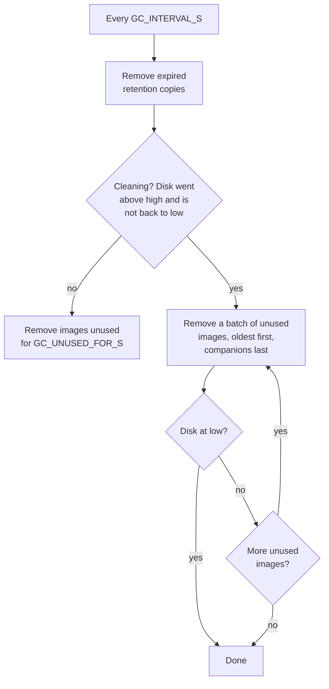
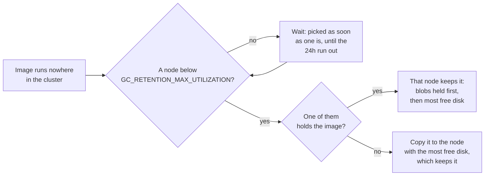

# Image cleanup

Each worker cleans up its own node's images, well before kubelet's
disk-pressure image GC would, and with more knowledge of which images matter.
The controller keeps one **retention copy** of every image the cluster stopped
running, so a rollback still finds it on a node.

## Rules

An image that isn't in use on the node is removed when **either** of these
holds:

- **It has been unused for `GC_UNUSED_FOR_S`** (1 hour), whatever the disk
  usage. The clock starts from the last time a container ran it on this node,
  or from when the node got it if it never ran there, for example after
  propagation.
- **The disk is above `GC_HIGH_UTILIZATION`** (70%). Unused images are then
  removed oldest first, however recently they ran, until the disk is back
  down to `GC_LOW_UTILIZATION` (40%).

A retention copy is outside both rules: see below. A
[companion image](companions.md) (a sidecar of app pods, kept on every node)
is outside the first: disk pressure removes it too, but only after every other
unused image.



## Retention copies

When the last container anywhere in the cluster stops using an image (a new
version replaced it, or its pods were removed), the controller picks **one**
node to keep it for `GC_RETENTION_TTL_S` (24 hours) after that moment. Every
other copy follows the rules above, so it's gone within the hour. A rollback
during those 24 hours pulls through the [mirror](mirror.md) from that node and
then from the peers that receive it, or, with the registry down, through
[rescue](rescue.md), instead of from the registry.



- **Which node:** among nodes whose disk is below
  `GC_RETENTION_MAX_UTILIZATION` (70%, the same as the cleanup's high mark),
  one that already holds the image, preferring a node holding the image's layer
  blobs (only blobs can be served by the mirror; a node with
  `discard_unpacked_layers = true` has only snapshots) and then the most free
  disk. Only if no node with room holds it is it copied, through rescue, to the
  node with the most free disk.
- **No room anywhere:** while every node is at or above the limit, no copy is
  kept (`angryduck_controller_retention_paused` is 1). As soon as a node is
  below it, the images that went unused meanwhile get their copy, as long as
  some node still holds them and their 24 hours aren't over.
- **The mark:** the chosen worker labels the image in containerd with
  `angryduck.io/last-survivor=<expiry, Unix seconds>`, on every name of the
  image. See it on a node with
  `ctr -n k8s.io images ls | grep last-survivor`.
- **Its own cleanup:** a marked image is never removed by the age rule or by
  disk pressure. When the mark's time is up it is removed at once, with no
  extra hour.
- **Used again:** if the image runs again anywhere, it needs no copy: the mark
  is removed and the image is an ordinary image again. When it goes unused
  again, a node is picked again.
- **Moved:** if the node keeping it goes away (deleted, drained, its worker
  gone) or no longer has it, the controller picks another node.
- **Nothing lost on a restart:** the mark is on the image, and workers report
  their marks, so a restarted controller picks every copy up again. A
  restarted worker keeps its marks.
- **Turning it off:** with `GC_RETENTION_ENABLED=false` (or `GC_ENABLED=false`)
  workers remove any mark at startup, and nothing is kept.

kubelet's own image GC doesn't know the mark. Keep kubelet's thresholds above
Angry Duck's and `imageMaximumGCAge` unset or longer than
`GC_RETENTION_TTL_S` (see [Node settings](node-settings.md)), or kubelet may
remove a retention copy early. The controller then picks another node, if one
still holds the image.

## When removing doesn't help

Images often aren't what fills a disk: running pods' images and writable
layers, emptyDir volumes and logs share it. Removing unused images then
frees almost nothing. So after each batch it measures the disk again: if the
batch freed less than 0.2% of it, the cleanup stops removing for disk
pressure, and logs what it saw. It tries again after an hour, or as soon as
the disk grows by 1% (new images arrived, maybe removable ones). The age rule
and expiring retention copies keep going meanwhile.
`angryduck_worker_gc_stalled` is 1 while it waits, and the Cleanup tab shows
the node as *stalled*.

If a node stays stalled, the disk itself is too small for the thresholds:
find what fills it, or raise `GC_HIGH_UTILIZATION` and `GC_LOW_UTILIZATION`
(and `PROPAGATE_MAX_UTILIZATION`, which keeps spreads off nodes above it).

## Never removed

- images in use on the node: a running container uses it, or a container of
  a pod that is still up does. A crashlooping container is exited most of the
  time, but kubelet restarts it from the same image, so its image stays. A
  completed Job's image doesn't: its pod is no longer up;
- images being pulled or received right now;
- a rescue's temporary base images;
- images whose name contains a `GC_PROTECT_SUBSTRINGS` entry (`pause` by
  default);
- a retention copy, until its time is up.

## Mechanics

- Usage is sampled every `GC_INTERVAL_S`. Usage times are saved under
  `RESCUE_STATE_DIR` on the node, so a worker restart doesn't make old images
  look new.
- Images are removed in batches of `GC_BATCH`. Under disk pressure, the worker
  waits `GC_SETTLE_S` after each batch for containerd to free the space, then
  measures again.
- Every name of an image (tag, `repo@digest`, image ID) is removed together,
  so containerd's garbage collector really frees its layers. Layers shared
  with images that stay are kept.
- With retention on, each worker adds the images its containers use (by target
  digest) and its retention copies to the reports it already sends, and only
  when they change. The controller acts on those reports as they arrive, and
  looks every `GC_RETENTION_INTERVAL_S` (30s) for what time alone changes: a
  copy expiring, a node going away, a node getting room again. A mark is one
  containerd label update; the cleanup reads marks from the image listing it
  already takes, so they cost no extra call.

## Working with kubelet and propagation

Keep the thresholds in this order:

```text
PROPAGATE_MAX_UTILIZATION  ≤  GC_HIGH_UTILIZATION  <  kubelet imageGCHighThresholdPercent
GC_RETENTION_MAX_UTILIZATION  ≤  GC_HIGH_UTILIZATION
```

Nodes that fill up are skipped by propagation, cleaned down to the low mark,
and then receive the image. kubelet's image GC stays as the last line of
defense.

## Metrics

| Metric | Meaning |
|---|---|
| `angryduck_worker_gc_images_deleted_total{tier}` | `old` (unused past `GC_UNUSED_FOR_S`), `pressure` (removed early for disk space), `retention` (an expired retention copy), or `error`. |
| `angryduck_worker_gc_image_returns{image}` | Images that came back within an hour of being removed, and how often: something still uses them. Only the last hour is kept. |
| `angryduck_worker_gc_candidates{tier}` | Images that could be removed right now: `old`, `pressure`. |
| `angryduck_worker_gc_retained_images` | Retention copies this node keeps. |
| `angryduck_worker_gc_cleaning` | 1 while the disk is above high and not yet back to low. |
| `angryduck_worker_gc_stalled` | 1 while disk-pressure removals are paused because they freed nothing. |
| `angryduck_controller_retention_copies{state}` | Retention copies: `held` (a node keeps it), `pending` (none picked yet), `copying`. |
| `angryduck_controller_retention_paused` | 1 while copies wait because every node is at or above `GC_RETENTION_MAX_UTILIZATION`. |
| `angryduck_controller_retention_events_total{event}` | `unused`, `kept`, `copied`, `used`, `lost`, `gone`, `expired`. |
| `angryduck_controller_image_retention_timestamp_seconds{image, node, event}` | The same events per image, for its history (see [Image history](observability.md#image-history)). |

A node with `gc_cleaning == 1` and no candidates in any tier is full of
running, protected or retained images; cleanup can't help it.

## Settings

`GC_ENABLED`, `GC_INTERVAL_S`, `GC_UNUSED_FOR_S`, `GC_HIGH_UTILIZATION`,
`GC_LOW_UTILIZATION`, `GC_BATCH`, `GC_SETTLE_S`, `GC_PROTECT_SUBSTRINGS`,
`GC_RETENTION_ENABLED`, `GC_RETENTION_TTL_S`, `GC_RETENTION_MAX_UTILIZATION`,
`GC_RETENTION_INTERVAL_S`. See [Configuration](configuration.md#image-cleanup).
