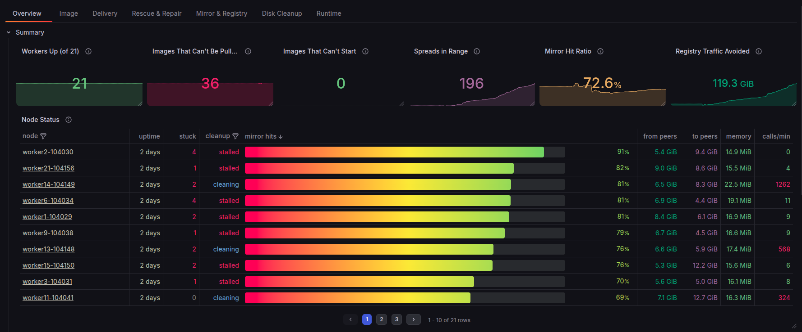
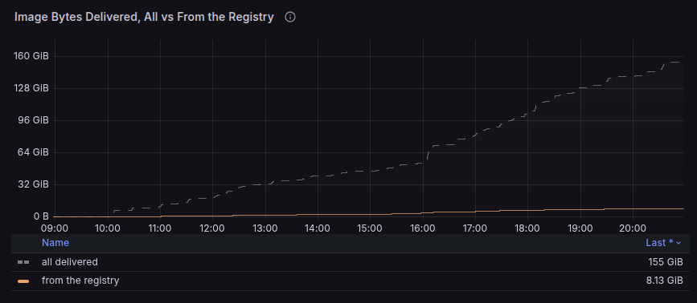
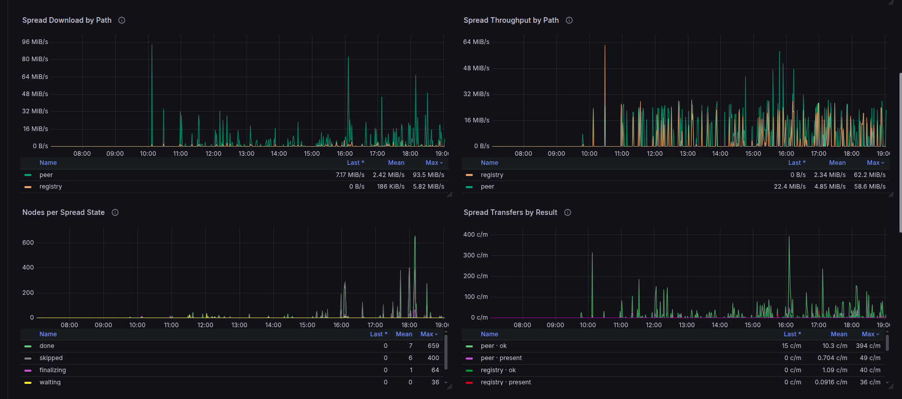
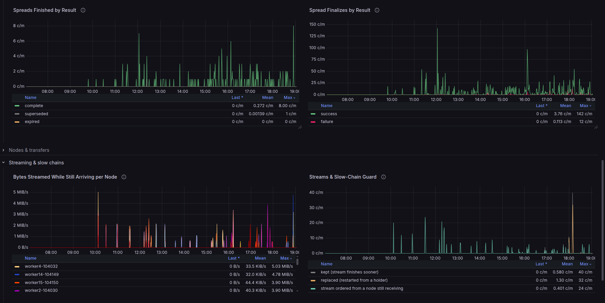
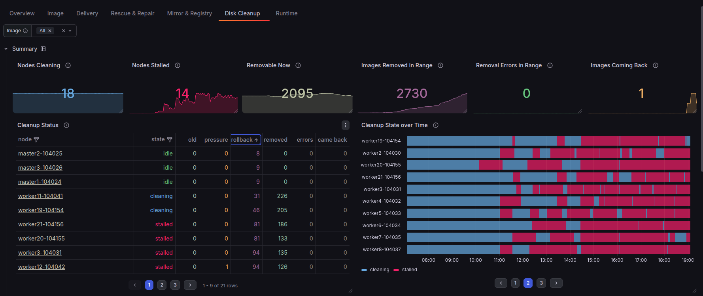
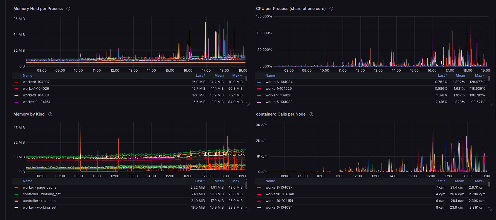
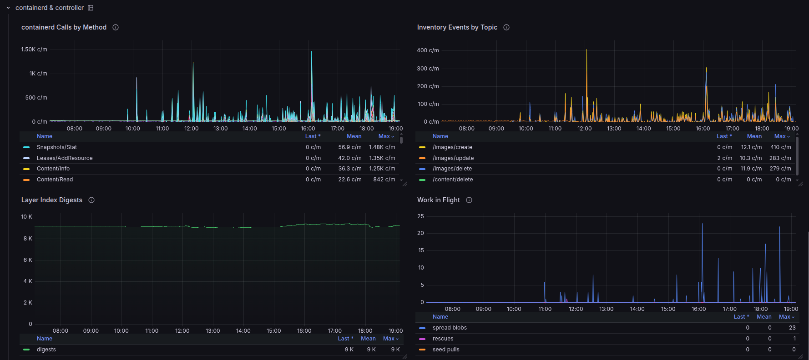

# Observability

Both components expose Prometheus metrics on `/metrics`. The manifests include
ServiceMonitors for the Prometheus Operator that scrape every 15 seconds.

## Grafana dashboard

[`grafana/angryduck-dashboard.json`](../grafana/angryduck-dashboard.json) has
one tab per concern. Each opens with a summary row: six numbers, then a status
table with one row per node, image, registry or process, then charts in pairs.
Detail rows follow.

Rows of things that only happen when something goes wrong, or only while a
spread runs (seed pulls, propagation, rescues, repairs, broken images, peer
traffic and leftovers, the transfers running right now), start collapsed: a
row title on a healthy cluster, the panels one click away. Empty panels say so
("Nothing is stuck pulling right now"). Lines don't break: a series that
disappears for a while (nothing stuck, no spread running) is drawn at 0. Long
tables page.

Numbers "in range" stay cheap on long ranges: counts and bytes are added up
interval by interval (their sparkline shows when it happened), ratios,
percentiles and distinct counts are read once. Busiest Workloads, which joins
every pod of the range, covers the last 24 hours.

Colors keep one meaning across the dashboard: green is fine, amber needs a
look, red is critical (a softer red when it is retried anyway), sky blue is
work in progress, teal is traffic kept inside the cluster, peach is registry
downloads, violet counts events, light blue is a duration. In tables a count of
problems stays grey at 0, node names are a warm grey, and image names take the
color of their registry (the regex value mappings on the *image* columns; add
yours there).

| Tab | Answers |
|---|---|
| **Overview** | Is Angry Duck healthy, and is it saving anything? Workers up out of the nodes the DaemonSet should run on, images that can't be pulled and images that can't start, spreads in the time range, mirror hit ratio, bytes from peers; a node table, worst first (uptime, stuck, broken, cleanup, mirror hits, bytes from and to peers, memory, containerd calls); where delivered image bytes came from, and all of them against the registry's share, added up over the range; stuck and broken images per node, and the nodes that lost containerd's events in the time range, if any. |
| **Impact** | What Angry Duck changes for the pods, and what it costs. Activity: new image versions, pod starts, kubelet's own pulls, pulls per pod start, pulls Angry Duck saved, restarts, and the workloads creating the most pods. Pulls and pod start: time spent pulling, its share of pod start, kubelet's pull p95, bytes kept off the registry, failed pulls, disk pressure, containers waiting on images, image delivery against all inbound node traffic. Kubelet pulls: pull time as a heatmap and as percentiles, pulls by image size, and pull time per image size and per node. Disk: containerd's disk per node, and disk pressure, evictions and kubelet's image GC if they happened. The node: Angry Duck's CPU throttling and memory against its limits, and disk busy. |
| **Image** | Everything about one image (pick it in **Tag**, or click it anywhere): the spread's progress, how long it took and how it ended; per node, how it got the image (peer, registry, seed, rescue, ...), how long after the preheat, bytes and time per side. *On the nodes*: per node, how many images are in use, unused, kept as the retention copy or broken, and how many go within the hour; then every node and image with its state, the pods running it there, when the cleanup removes it (red under 10 minutes), its size and when the node got it. The components and pods using one picked tag, on which nodes and in which state; seed pulls, repairs, which nodes removed it and when the next ones will. On *All*, the tables list every recent image. |
| **Delivery** | How images reach nodes: every running spread with nodes and layers per state, what each node still lacks, the transfers running, throughput per path, streaming and the slow-chain guard, bytes resumed and thrown away, layers unpacked on arrival; *Timings* (collapsed): how long each stage of a blob's life on a node takes (source answer, transfer, commit, unpack by compression, where the worker's own unpacks spend their time, registering, time to ready), stage by stage and node by node; seed pulls; preheat and propagation in collapsed rows. |
| **Rescue & Repair** | What is stuck or broken, and who it hits: stuck pulls per node and image with why the pull failed, rescue state and failures in a row, broken images, the pods waiting on them and kubelet's reason, rescues, layers by delivery method, repairs and their downloads. |
| **Mirror & Registry** | The mirror's hit ratio (per node in the Overview's node table), requests and bytes; tags it resolved, by what the registry answered and where the manifest came from; what each registry answered at the last origin check; images their registry no longer serves, the copies left and the containers using them. |
| **Disk Cleanup** | Cleanup state per node over time, images removable per tier, images removed, failed removals, images coming back after removal; retention copies; companion images kept on every node and where each is missing; image by image, what was removed from which node and what comes up next, and when. |
| **Runtime** | Angry Duck's own cost: processes, versions, restarts, memory really held (`rss_anon`), CPU, containerd calls per node and method, connections each worker holds open with peers and the controller; the Page cache row: file cache counted as each worker's memory, next to what its page cache tracker holds; inventory events, the controller's layer index and work in flight. |

Every panel has a one-line description (hover its title). Click a node or an
image anywhere, in a table or a chart, to focus the whole dashboard on it.

**Overview.** The node table is sorted here by mirror hits; it opens sorted
with the nodes that have stuck images first.



**Image bytes delivered, and how much came from the registry.** The dashed
line is everything Angry Duck delivered to the nodes; the solid one is the part
the registry served. It isn't a "without Angry Duck" estimate: spreads reach
every eligible node, including nodes that never run the image, and registry
pulls containerd makes on its own (seed pulls, mirror misses) aren't measured
in bytes.



**Delivery.** Spread traffic by path, throughput, nodes per state and
transfers by result; below, spreads and finalizes by result, and streaming.
The *Resumed & thrown-away bytes* row shows the bytes nodes didn't fetch
again because a transfer went on from what a stopped one left, and the
bytes they received and threw away, by reason.





**Disk Cleanup.** These nodes are full of container logs: cleanup removes
every image it safely can and reports the node *stalled* rather than deleting
more. The *Retention copies* row below the summary shows the images the
cluster stopped running, the node keeping each and when its copy expires, and
what happened to each copy; on the Image tab, *The Image on Each Node* shows a
retention copy as *kept for rollbacks*. The *Companion images* row below it
shows the sidecars kept on every node, the space they take, the nodes still
missing each, and any removed under disk pressure.



**Runtime.** What Angry Duck itself costs: about 15 MiB of memory and 2% of a
core per worker on a busy day.





The file uses Grafana's dashboard schema v2 (`dashboard.grafana.app/v2`), for
the tabs, and was built with Grafana 13. To import it, go to **Dashboards → New
→ Import**, upload the file and pick your Prometheus data source in the
**Data source** variable.

Variables:

- **Data source**: a Prometheus or Mimir data source.
- **Cluster**: values of the `k8s_source_cluster` label, for setups that
  aggregate several clusters. Without that label, leave it on *All*. If your
  cluster label has another name, replace `k8s_source_cluster` in the JSON.
- **Node**: applies to every per-node metric.
- **Registry**: the registries of the images Angry Duck is busy with, or has
  [history](#image-history) for in the time range. Applies to every image on
  every tab.
- **Image**: those images without their tag (`registry/path/name`), within the
  picked registries. Applies to every image on every tab, tagged or not.
- **Tag**, on each tab that lists images (Image, Delivery, Rescue & Repair,
  Mirror & Registry, Disk Cleanup): the tags of the picked images:
  spreading, delivered, stuck, broken, repaired, pulled, removed or coming up
  for removal, gone from their registry. Clicking an image in a table picks it
  on that tab. Counters over time carry no image label, by design, to keep the
  number of series bounded.

Annotations, in the dashboard's controls: **Rollouts** (a new version's first
process), **Restarts** (a process restarted with the same version: a crash, an
eviction, a reboot; a rollout's restarts aren't marked), **Problems** (a
rescue or repair failed, a cleanup stalled, a registry unreachable; the mark
says which, and where) and **Spreads** (off by default).

The pod and component views use kube-state-metrics in the same data source
(`kube_pod_container_info`, `kube_pod_info`, `kube_pod_owner`,
`kube_replicaset_owner`, `kube_job_owner`, `kube_pod_start_time` and the
`kube_pod_container_status_*` series). A pod is tied to its component through
its owner: a Deployment through its ReplicaSet, a CronJob through its Job.
Images are matched on the image as written in the pod spec
(`image_spec`). That equals Angry Duck's `image` label for references with a
registry host and a tag (`registry.example.com/team/app:v1`); Docker Hub short
names (`nginx`) don't match. *Workers Up* compares with the worker
DaemonSet's `kube_daemonset_status_desired_number_scheduled`. CPU comes from cAdvisor
(`container_cpu_usage_seconds_total`, containers `worker` and `controller`).
Without them, those panels stay empty and everything else works.

The **Impact** tab also reads kubelet's own metrics
(`kubelet_image_pull_duration_seconds`, `kubelet_pod_start_duration_seconds`,
`kubelet_runtime_operations_errors_total`, `kubelet_evictions`,
`kubelet_image_garbage_collected_total`; the last ones only exist on recent
Kubernetes versions), cAdvisor's CPU throttling and working set,
kube-state-metrics' `kube_pod_created`, `kube_node_status_condition` and
`kube_pod_container_resource_limits`, and node-exporter's filesystem, network
and disk series. Kubelet series are filtered on a `node` label, as the
kube-prometheus-stack scrape adds it; node-exporter series are tied to nodes
through `node_uname_info`'s `nodename`, which has to equal the Kubernetes node
name. A panel whose metrics are missing stays empty.

Read it top to bottom. *Activity* is the context: how many new image versions
and pod starts the cluster had decides how many pulls there could be. *Pulls
Saved by Angry Duck* next to *Kubelet Pulls* is the score: many saved and few
made means preheat and spreads keep up with the churn; many made means images
arrive that were never spread (a pipeline that doesn't call the webhook, Jobs
from another registry) or keep leaving the nodes (check *Images Coming Back*
on the Disk Cleanup tab), or containers ask the registry every time
(`imagePullPolicy: Always`). *Busiest Workloads* names the likely sources; a
CronJob near the top usually explains a high *Pulls per Pod Start* on its own.
A steady *failed pulls* line is pods stuck on an image nobody has, not a
rollout: find them on the Rescue & Repair tab.

Kubelet doesn't say which pod a pull was for, or how long it queued before
pulling (only its events do), and its pull histogram jumps from 1 to 2 minutes,
so a p95 of 1.8 minutes means "between one and two". The *last hour* charts
leave a gap, rather than a 0, where nothing started or pulled in the hour
before: an average of 0 seconds would read as instant.

Annotations, toggled from the dashboard controls: Angry Duck versions rolling
out and process restarts, on every chart; rescue failures and repair failures,
on the rescue and repair charts; disk cleanup stalling, on the cleanup charts;
a registry becoming unreachable, on the mirror and origin charts; spreads
starting (off: with hundreds of spreads a day they would cover every chart),
on the delivery charts. A node or registry that flaps between stalled and not
(or reachable and not) is marked once, not at every flap: a mark needs 30
minutes without one before it. The **Reset filters**
link keeps data source, cluster, time range and the current tab, and clears
the rest.

## Metrics

Every counter exists from the start, at zero, for every label value it can
take (per node as soon as the node reports), so `rate()` and `increase()` see
the first event too.

### Controller

| Metric | Type | Labels | Meaning |
|---|---|---|---|
| `angryduck_controller_origin_images` | gauge | `registry`, `status` | Distinct images on fresh nodes, by registry and its answer at the last [origin check](#origin-check): `ok`, `missing`, `denied`, `unreachable`, `unchecked`. |
| `angryduck_controller_origin_unavailable` | gauge | `image`, `status` | Images a registry didn't serve (`missing` or `denied`); the value is how many fresh nodes still hold a copy. Only such images are listed. |
| `angryduck_controller_origin_checks_total` | counter | `status` | Origin checks sent, by answer. |
| `angryduck_controller_pull_orders_total` | counter | `node`, `result`, `registry` | Seed pull orders sent to workers: `success` or `failure`. |
| `angryduck_controller_seed_rankings_total` | counter | `basis` | How seeds were ranked: `layers`, or the `repo` and `utilization` fallbacks. |
| `angryduck_controller_seed_missing_bytes` | gauge | `node` | Bytes of the latest seeded image each seed lacked, i.e. its registry download. |
| `angryduck_controller_seed_timeouts_total` | counter | `node` | Slow seed pulls cancelled in favor of peers. |
| `angryduck_controller_layer_index_digests` | gauge | | Distinct blob digests and snapshot chainIDs across all nodes. |
| `angryduck_controller_propagations_total` | counter | `result` | Finished propagations: `complete`, `superseded` or `expired`. |
| `angryduck_controller_propagation_transfers_total` | counter | `node`, `result` | Transfers ordered while spreading images. |
| `angryduck_controller_propagation_nodes` | gauge | `image`, `state` | Nodes per image: `have`, `missing`, `in_flight`, `seeding`, `skipped`. |
| `angryduck_controller_rescues_total` | counter | `node`, `result` | `success`, `failure`, `no_source`, `no_target` (before 1.14.10 also `pull_policy_always`). |
| `angryduck_controller_rescue_stuck_images` | gauge | `node` | Images each node can't pull right now. |
| `angryduck_controller_rescue_consecutive_failures` | gauge | `node`, `image` | Failed attempts in a row, for pairs with at least one failure. |
| `angryduck_controller_rescues_in_flight` | gauge | | Rescues running now. |
| `angryduck_controller_rescue_stuck_pods` | gauge | `node`, `image`, `cause`, `in_flight` | Pods stuck per node and image, and why the pull failed (`cause`, as below); `in_flight` 1 while a rescue runs for it. Only pairs stuck now. |
| `angryduck_controller_rescues_by_cause_total` | counter | `cause`, `result` | Rescue decisions across the cluster by why the pull failed, read from kubelet's message: `missing` (the registry doesn't have it), `denied` (the pod's pull secret was refused), `unreachable` (no usable answer), `other`. `result` as in `rescues_total`. |
| `angryduck_controller_repair_orders_total` | counter | `node`, `result` | Repair orders sent because a container failed to start on a broken image (`CreateContainerError`): `sent`, `failed`, `no_worker`. |
| `angryduck_controller_retention_copies` | gauge | `state` | [Retention copies](image-cleanup.md#retention-copies): `held` (a node keeps it), `pending` (no node picked yet), `copying` (being copied to a node with room). |
| `angryduck_controller_retention_paused` | gauge | | 1 while copies wait because every node is at or above `GC_RETENTION_MAX_UTILIZATION`. |
| `angryduck_controller_retention_events_total` | counter | `event` | `unused` (an image went unused everywhere), `kept` (a node keeps the copy), `copied`, `used` (runs again), `lost` (its node went away or dropped it), `gone` (no node holds it), `expired`. |
| `angryduck_controller_companion_images` | gauge | `state` | [Companion images](companions.md): `kept`, `too_large` (above `COMPANION_MAX_MB`), `size_unknown`. |
| `angryduck_controller_companion_bytes` | gauge | | Bytes of the kept companion images together. |
| `angryduck_controller_companion_nodes` | gauge | `image`, `state` | Per kept companion image: nodes that `have` it, are `missing` it, or are `skipped`. One series per kept image and state. |
| `angryduck_controller_companion_transfers_total` | counter | `result` | Companion images copied to nodes from peers: `success`, `failure`. |

<a id="spread"></a>Spread. Series labeled `image` or `node` exist only while
that image is being spread and drop when it ends, so their number follows
what is moving, not history:

| Metric | Type | Labels | Meaning |
|---|---|---|---|
| `angryduck_controller_spread_nodes` | gauge | `image`, `state` | Nodes per image: `done`, `finalizing`, `transferring`, `waiting`, `skipped`. A complete spread still open only for full nodes publishes nothing until one of them starts receiving. |
| `angryduck_controller_spread_layers` | gauge | `image`, `state` | Layers per image: `held` (peers can fetch it), `pulling` (only coming from the registry now), `missing`. |
| `angryduck_controller_spread_node_missing_layers` | gauge | `image`, `node` | Layers each node still lacks. Nodes not done and not too full only. |
| `angryduck_controller_spread_node_missing_bytes` | gauge | `image`, `node` | Bytes each node still lacks. Nodes not done and not too full only. |
| `angryduck_controller_spread_transfer_bytes` | gauge | `image`, `node`, `path`, `source`, `blob` | One series per transfer running now, its blob's size. At most two per node. |
| `angryduck_controller_spread_transfers_total` | counter | `path`, `result` | Transfers ended: `ok`, `failed`, `cancelled` (lost a race), `present`, `rejected`, `upstream` (a stream broke because its source's own transfer stopped). |
| `angryduck_controller_spread_stream_orders_total` | counter | | Peer transfers ordered from a node still receiving the blob, which streams it on. |
| `angryduck_controller_spread_slow_total` | counter | `action` | What the slow-chain guard did about late transfers: `race` (a late streamed registry pull raced), `replaced` (a late stream restarted from a holder), `kept` (the receiver judged its stream finishes sooner). |
| `angryduck_controller_spread_bytes_total` | counter | `path` | Bytes received for spreads. `path="registry"` is everything the registry served for them. |
| `angryduck_controller_spread_finalizes_total` | counter | `result` | Nodes registering a spread image. |
| `angryduck_controller_spreads_total` | counter | `result` | Spreads ended: `complete`, `superseded`, `expired`. |
| `angryduck_controller_spread_starts_total` | counter | `result` | How preheats started: `first` (manifest read at once), `retried` (read after retries), `fallback` (never read in `TARGET_TTL_S`, or refused: seeded whole), `superseded` (a newer tag came first). |
| `angryduck_controller_spread_last_duration_seconds` | gauge | | Preheat to last node registered, for the last complete spread. |

### Worker

| Metric | Type | Labels | Meaning |
|---|---|---|---|
| `angryduck_worker_pulls_total` | counter | `node`, `result`, `registry` | Seed pulls: `success`, `failure`, `cancelled`. |
| `angryduck_worker_pull_seconds_total` | counter | `node`, `result`, `registry` | Seconds spent in seed pulls. Divide by `pulls_total` for the average. |
| `angryduck_worker_pulls_in_flight` | gauge | `node` | Seed pulls running now. |
| `angryduck_worker_rescues_total` | counter | `node`, `reason`, `result` | Images fetched from peers. `reason`: `rescue`, `propagate`, or `retain` (copying a retention copy to a node with room). `result`: `success`, `failure`, `already_present`. |
| `angryduck_worker_rescue_bytes_total` | counter | `node`, `direction` | Bytes moved between nodes, `served` or `received`. |
| `angryduck_worker_rescue_layers_total` | counter | `node`, `method` | Layers by delivery: `present`, `blob`, `snapshot`. |
| `angryduck_worker_rescue_pinned_snapshots` | gauge | `node` | Snapshots pinned for a retry. |
| `angryduck_worker_rescue_cleanups_total` | counter | `node`, `kind` | Leftovers removed: `temp_snapshot`, `temp_image`, `expired_pin`. |
| `angryduck_worker_gc_stalled` | gauge | `node` | 1 while disk-pressure removals are paused because they freed nothing. |
| `angryduck_worker_spread_transfers_total` | counter | `node`, `path`, `result` | Spread blobs fetched, by `path` (`registry`, `peer`) and `result` (`ok`, `failed`, `cancelled`). |
| `angryduck_worker_spread_bytes_total` | counter | `node`, `path` | Spread bytes received (`registry`, `peer`) or `served` to peers. A resumed transfer counts only what it received itself. |
| `angryduck_worker_spread_resumed_bytes_total` | counter | `node`, `path` | Bytes of blobs a node committed for spreads without fetching them again: the transfer that committed the blob (over `path`) went on from what an earlier, stopped transfer left ([resuming](propagation.md#transfers-that-stop-part-way)). Only with `SPREAD_RESUME_ENABLED`. |
| `angryduck_worker_spread_discarded_bytes_total` | counter | `node`, `reason` | Spread bytes a node received and threw away: `lost_race` (the blob came the other way first), `dropped` (job dropped or superseded), `restarted` (the next source could only send the whole blob), `failed` (a failed transfer's bytes that couldn't be kept: containerd rejected them, or resuming is off), `unused` (kept for a next transfer that never came while the job ran). Also in `spread_bytes_total`. |
| `angryduck_worker_spread_streamed_bytes_total` | counter | `node` | Bytes served to peers from blobs this node was still receiving (part of `served`). |
| `angryduck_worker_spread_transfer_milliseconds_total` | counter | `node`, `path` | Time spent transferring. Bytes divided by it is the throughput per path. |
| `angryduck_worker_spread_active` | gauge | `node`, `path` | Blobs coming in right now on that path (any number; one blob at most once per path). |
| `angryduck_worker_direct_writes_total` | counter | `node`, `result` | Blobs written straight into containerd's ingest files (`DIRECT_WRITES`): `ok`, `failed` (aborted, as a failed transfer through the API would be), or `kept` (a spread transfer stopped part-way; its bytes stay for the next transfer of the blob). |
| `angryduck_worker_page_cache_released_bytes_total` | counter | `node` | Page cache handed back after serving blob files: the pages this worker's reads brought in, once the file was idle for `PAGE_CACHE_RELEASE_AFTER_S`. |
| `angryduck_worker_page_cache_tracked_bytes` | gauge | `node`, `state` | Page cache this worker's reads of blob files may have brought in (pages that weren't cached before), by `state`: `reading` (a reader still has the file open) or `idle` (handed back once `PAGE_CACHE_RELEASE_AFTER_S` passes). It falls back to 0 between transfers; a level that holds for hours is a reader that never let go. |
| `angryduck_worker_page_cache_tracked_files` | gauge | `node`, `state` | Blob files whose page cache the worker tracks, by `state`. |
| `angryduck_worker_spread_finalizes_total` | counter | `node`, `result` | Images registered from spread blobs. |
| `angryduck_worker_spread_unpacks_total` | counter | `node`, `result` | Layers unpacked as they arrived, before the image registered: `applied` (once the blob landed), `present` (already unpacked) or `failed` (left to the image's own unpack). With [unpacking while blobs arrive](stream-unpack.md) on, also `streamed` (while the blob was still arriving) and `stream_failed` (that failed: unpacked once it landed instead). |
| `angryduck_worker_spread_finalizing` | gauge | `node` | Images being registered (imported and unpacked) right now. Different images run side by side. |
| `angryduck_worker_mirror_requests_total` | counter | `node`, `kind`, `result` | Mirror requests (`blob`, `manifest`): `local`, `peer`, `stream` (from a peer still receiving it in a spread; blobs only), `miss`, `error`. |
| `angryduck_worker_mirror_bytes_total` | counter | `node`, `source` | Bytes the mirror served, `local`, `peer` or `stream`. |
| `angryduck_worker_mirror_peer_served_bytes_total` | counter | `node` | Bytes served to other nodes' mirrors. |
| `angryduck_worker_mirror_resolves_total` | counter | `node`, `origin`, `result` | Tags the mirror resolved: the registry's answer (`ok`, `missing`, `denied`, `unreachable`, `unservable`; `unchecked` when no node holds the tag) and where the manifest came from (`local`, `peer`, `miss`). Any `origin` but `ok` with `local` or `peer` is a pull the registry alone would have failed. |
| `angryduck_worker_mirror_controller_unreachable` | gauge | `node` | `1` while the node's mirror leaves the controller alone after it didn't answer in time (from `MIRROR_CONTROLLER_BACKOFF_MIN_MS`, doubling up to `MIRROR_CONTROLLER_BACKOFF_MAX_MS`): content the node doesn't hold goes straight to the registry. |
| `angryduck_worker_inventory_events_total` | counter | `node`, `topic` | containerd events that changed what the node can serve; each burst settles into one inventory report. |
| `angryduck_worker_inventory_watch_up` | gauge | `node` | 1 while the node follows containerd's events, 0 while it falls back to periodic layer scans. |
| `angryduck_worker_gc_images_deleted_total` | counter | `node`, `tier` | Images removed: `old`, `pressure`, `companion` (a [companion image](companions.md), under disk pressure, last), `retention` (an expired [retention copy](image-cleanup.md#retention-copies)), or `error`. |
| `angryduck_worker_gc_image_returns` | gauge | `node`, `image` | Images that came back within an hour of cleanup removing them, and how many times. Only images that came back in the last hour, so the series count stays small. |
| `angryduck_worker_gc_candidates` | gauge | `node`, `tier` | Images removable right now: `old`, `pressure`, and `companion` (only under disk pressure, after the others; with companions on). |
| `angryduck_worker_gc_retained_images` | gauge | `node` | Retention copies this node keeps (marked `angryduck.io/last-survivor`), not yet expired. Only with retention on. |
| `angryduck_worker_gc_cleaning` | gauge | `node` | 1 while the disk is above high and not yet back to low. |
| `angryduck_worker_broken_image` | gauge | `node`, `image` | 1 while that image is registered on the node but can't start a container. Removed once it is repaired or no longer registered. |
| `angryduck_worker_image_repairs_total` | counter | `node`, `result` | Broken images repaired in place (`repaired`), or not (`failed`: some piece came from no peer and not from the registry; retried at the next check). |
| `angryduck_worker_repair_bytes_total` | counter | `node`, `source` | Bytes repairs fetched, from a `peer` or the `registry`. |
| `angryduck_worker_temp_images_removed_total` | counter | `node` | Temporary import names a killed worker left behind, removed by the repair. |
| `angryduck_worker_preheated_containers_running` | gauge | `node`, `repo` | Running containers from repos recently preheated on the node. |

| `angryduck_worker_peer_connections` | gauge | `node`, `direction` | Open TCP connections between this worker and other Angry Duck processes: `in`, accepted by its API (`WORKER_LISTEN_ADDR`) from peers and the controller; `out`, opened by its spread, repair, rescue and mirror to other workers' API, and by the mirror to the controller. Idle ones close when the work that used them ends, or after `IDLE_CONN_TIMEOUT_S`, so between jobs it drops back toward 0. |
| `angryduck_worker_containerd_calls_total` | counter | `node`, `method` | gRPC calls to containerd, by service and method (`Content/List`, `ImageService/PullImage`, ...). The load the worker puts on containerd. |

The `registry` label is filled only with `METRICS_LABEL_REGISTRY=true`.

<a id="durations"></a>Durations. Histograms of how long each stage of a blob's
life on a node took, so a slow registry, a slow disk, slow decompression or
one unusually slow layer shows up in a quantile instead of an average. They
record **successful** operations only; failures and cancellations stay in
the counters above. Labels are the node, small fixed vocabularies and a
size class (`small` under 8 MiB, `medium` under 64 MiB, `large` from there),
never an image, digest or layer; per-image detail stays in
[image history](#image-history). Buckets, in seconds: 0.05 to 300.

The series of every stage a node can go through exist at zero from the
worker's start: spreads come in bursts and an image is finalized once per
node, and `rate()` and `increase()` only count what happens after a
series' first scrape, so a series born holding its first observations
would never show them. Only stages of features that are on get series
(stream unpack, parallel unpack, direct writes, rescue, repair); a
compression of `other` appears with its first observation. With spread,
unpack on arrival, direct writes, rescue and repair on, a worker has 39
series (585 lines per scrape); with stream and parallel unpack too, 59
(885 lines). Creating them allocates about 16 KiB once, at start
(measured, every feature on).

A blob, in the order it happens:

| Stage | Metric | Labels | Meaning |
|---|---|---|---|
| Source answers | `angryduck_worker_blob_open_seconds` | `node`, `path` | From asking a source for a blob until it starts answering (headers, before the first byte): the registry's auth, redirects and queueing, or a peer's answer. `path`: `registry`, `peer`. |
| Transfer | `angryduck_worker_blob_fetch_seconds` | `node`, `path`, `size_class` | One spread blob transfer into containerd's content store, all of it: the source answering, the download, the writes and the commit. Whole blobs from byte 0 only: a resumed transfer isn't in it. |
| Commit | `angryduck_worker_blob_commit_seconds` | `node`, `mode`, `size_class` | containerd committing a written blob (digest check and rename into the store). `mode`: `api`, or `direct` (`DIRECT_WRITES`). |
| Unpack | `angryduck_worker_layer_unpack_seconds` | `node`, `method`, `compression`, `size_class` | Turning one layer blob into files in a snapshot: decompressing and writing, nothing else (preparing and committing the snapshot are not in it). `method`: `landed` (containerd, from the landed blob), `streamed` (this worker, while the blob arrived: includes waiting for its bytes), `landed_own` (this worker, from the landed blob). `compression`, from the blob's media type: `gzip`, `zstd`, `none` (a plain tar), `other`. `size_class` is the compressed size. |
| Inside the worker's unpack | `angryduck_worker_layer_unpack_stage_seconds` | `node`, `stage`, `compression` | For layers this worker unpacks itself (`streamed`, `landed_own`), one observation per stage per layer: `input` (waiting for the blob's bytes: the network or a peer while it arrives, the disk once landed), `decompress` (decompressing, waiting on neither side), `write` (writing files, waiting on neither side). The three run side by side, so they overlap and don't add up to the unpack time: the one closest to it is the bottleneck. |
| Snapshot commit | `angryduck_worker_layer_commit_seconds` | `node`, `kind` | Committing an unpacked layer's snapshot under its chainID. `kind`: `in_place` (unpacked onto the layer below, committed right after), `onto_parent` (unpacked on its own by containerd, committed onto the layer below), `attach` (unpacked on its own by this worker, its files moved onto the layer below, then committed). |
| From a peer, unpacked | `angryduck_worker_snapshot_receive_seconds` | `node`, `size_class` | One layer received as a snapshot from a peer and committed locally (a peer that holds the layer unpacked but has no blob, e.g. with containerd's `discard_unpacked_layers`). Transfer and apply are streamed together, so it is one number; it is not in `blob_fetch_seconds`. `size_class` is the bytes on the wire. |

Then the image:

| Stage | Metric | Labels | Meaning |
|---|---|---|---|
| Finalize | `angryduck_worker_spread_finalize_seconds` | `node`, `phase` | Before containerd's import: `drain` (waiting for layers still unpacking as they arrived; recorded only when one was), `hold` (checking and pinning the layers). |
| Import | `angryduck_worker_import_seconds` | `node`, `caller`, `phase` | Every containerd import this worker makes, by `caller` (`spread`, `rescue`, `repair`) and `phase`: `register` (reading the archive, creating the image under a temporary name), `unpack` (containerd unpacking layers that have no snapshot yet; near zero when they were unpacked ahead), `publish` (pointing the real name at it). |
| Ready | `angryduck_worker_spread_ready_seconds` | `node` | From the first transfer or layer check this node made for a spread until its image name was registered: the node-local time to image ready. A spread whose job here was forgotten before it finished (idle for longer than its lease lives) is not recorded. |
| Slots | `angryduck_worker_unpack_slots` (gauge) | `node`, `state` | Layer unpack slots across spreads: `in_use` now and `max` (`SPREAD_UNPACK_PARALLEL_MAX`). Only with parallel unpacking on. `in_use` pinned at `max` while layers still wait is serialization. |
| Resolve | `angryduck_registry_request_seconds` | `kind` | Both components. `resolve`: how long the registry took to give an image's manifest, index and config (cache misses only). No node or image label. A blob's time to first byte is `blob_open_seconds{path="registry"}`. |

Reading them together, for a layer that streamed in from the registry:
`blob_open` is the registry's answer time, `blob_fetch - blob_open -
blob_commit` is the download plus writes, `blob_commit` is verification. The
unpack overlaps the fetch, so it is not added to it; its stage split says
whether the network (`input`), the CPU (`decompress`) or the disk (`write`)
held it back. For a layer containerd unpacks (`method="landed"`, every zstd
layer), decompressing and writing happen inside one containerd call, so only
the total and the compression are known.

The Delivery tab's **Timings** row shows all of this: every stage in order
with its count, average, p50 and p95; the p95 of the main stages per node;
transfers by path and size; source answer times; unpacks by who and by
compression; where the worker's own unpacks spend their time; registering
by phase; the node-local time to ready; unpack slots.

```promql
# p95 time to download+ingest a large blob, by source
histogram_quantile(0.95, sum by (le, path) (
  rate(angryduck_worker_blob_fetch_seconds_bucket{size_class="large"}[15m])))
# registry time to first byte, p95
histogram_quantile(0.95, sum by (le) (
  rate(angryduck_worker_blob_open_seconds_bucket{path="registry"}[15m])))
# p95 unpack time by compression
histogram_quantile(0.95, sum by (le, compression) (
  rate(angryduck_worker_layer_unpack_seconds_bucket[15m])))
# the worker's own unpacks: average seconds per layer, per stage
sum by (stage) (rate(angryduck_worker_layer_unpack_stage_seconds_sum[1h]))
  / sum by (stage) (rate(angryduck_worker_layer_unpack_stage_seconds_count[1h]))
# share of unpacks done while the blob arrived (needs stream unpack on)
sum(rate(angryduck_worker_layer_unpack_seconds_count{method="streamed"}[1h]))
  / sum(rate(angryduck_worker_layer_unpack_seconds_count[1h]))
# unpack slot saturation per node
angryduck_worker_unpack_slots{state="in_use"} / ignoring(state) angryduck_worker_unpack_slots{state="max"}
```

### Both components

| Metric | Type | Labels | Meaning |
|---|---|---|---|
| `angryduck_build_info` | gauge | `component`, `version`, `node` | One series per process: its version, and as the value the Unix time it started. |
| `angryduck_process_memory_bytes` | gauge | `component`, `kind` | Read at each scrape. `rss_anon`: memory the process really holds. `rss_file`: its own code, shared and reclaimable by the kernel. `heap_live`: what the Go heap needs right now. `heap_retained`: freed heap kept for reuse. `heap_released`: already returned to the OS. `stacks`: goroutine stacks. From the container's cgroup: `working_set`, what `kubectl top` and `container_memory_working_set_bytes` show, and `page_cache`, the file cache charged to the container (files it read, its own binary), split into `page_cache_active` (counted in `working_set`) and `page_cache_inactive` (not counted, the first the kernel takes back); `page_cache_dirty`, written but not yet on disk; `shmem`, tmpfs and shared memory, which stays until freed; `slab_reclaimable` (cgroup v2 only), the kernel's records of files the container created or opened (inodes, directory entries), counted in `working_set` and freed once the files are deleted or the node needs memory (with unpacking while blobs arrive, the worker hands it back a few seconds after each unpack). |

`rss_anon` is the number to size against; container memory usage
(`container_memory_working_set_bytes`, `working_set` here) also counts
`rss_file`, which the kernel can drop and reload at will, and the page cache
of files the container read. A few seconds after a burst of work ends (a
transfer, a request, a pass over the images), and at least once a minute, if
`heap_retained` is above 1 MiB, the process hands it back to the OS, so
`rss_anon` returns to near its idle level. A worker also gives back the page
cache its blob reads brought in once a blob has been idle for
`PAGE_CACHE_RELEASE_AFTER_S`, so serving images doesn't leave its
`working_set` high.

If a worker's `working_set` stays up anyway, `page_cache_active` shows how much
of it is file cache, and `angryduck_worker_page_cache_tracked_bytes` whether the
worker still tracks those pages: held there, a reader never let go; at zero, the
pages came from somewhere the worker doesn't track. The dashboard's Runtime tab
puts the two side by side (Page cache row).

Useful queries:

```promql
# containerd calls per minute, per worker
sum by (node) (rate(angryduck_worker_containerd_calls_total[5m])) * 60
# memory each worker really holds
angryduck_process_memory_bytes{component="worker", kind="rss_anon"}
# file cache counted in each worker's memory
angryduck_process_memory_bytes{component="worker", kind="page_cache_active"}
```

<a id="image-history"></a>
### Image history

Spreads, deliveries, pulls, repairs and removals are events, and the counters
above carry no image label. So both components also publish each event, per
image, as a gauge that stays on `/metrics` for `METRICS_EVENT_TTL_S` (15
seconds) after it happened: long enough for Prometheus to scrape it once.
Prometheus keeps the history; the dashboard reads it back over its time range
with `last_over_time`. Neither process holds more than the last few seconds of
events, and each metric is capped at 5000 series. The one exception is a spread
still running: its `running` duration stays until it ends.
`METRICS_EVENT_TTL_S=0` turns them off.

Match the TTL to your scrape interval. An event that leaves `/metrics` before
a scrape (a scrape that failed, ran late, or a Prometheus restart) is lost.

| Metric | Labels | Meaning |
|---|---|---|
| `angryduck_controller_image_spread_started_timestamp_seconds` | `image` | When a spread (or whole-image propagation) of it started. |
| `angryduck_controller_image_spread_seconds` | `image`, `result` | How long it took: `complete`, `superseded`, `expired`; `running` (so far) while it runs. |
| `angryduck_controller_image_delivered_timestamp_seconds` | `image`, `node`, `via` | When a node got the image. |
| `angryduck_controller_image_delivery_seconds` | `image`, `node`, `via` | How long after the preheat it got it (for a rescue, after its pull got stuck). |
| `angryduck_controller_image_received_bytes` | `image`, `node`, `path` | Bytes the node received for it: `registry`, `peer`, `image`, `propagate`, `rescue`. Set when the node got it, or when its spread ended without it. |
| `angryduck_controller_image_transfer_seconds` | `image`, `node`, `path` | Seconds spent receiving it, summed over transfers. |
| `angryduck_controller_image_retention_timestamp_seconds` | `image`, `node`, `event` | When something happened to its [retention copy](image-cleanup.md#retention-copies): `unused` (went unused in the cluster; no node), `kept`, `copied`, `used` (runs again), `lost`, `gone` (no node holds it; no node), `expired`. |
| `angryduck_worker_image_pull_seconds` | `node`, `image`, `result` | A seed pull of it from the registry. |
| `angryduck_worker_image_repair_seconds` | `node`, `image`, `result` | A repair of it: `repaired`, `failed`. |
| `angryduck_worker_image_repair_timestamp_seconds` | `node`, `image`, `result` | When that repair ended. |
| `angryduck_worker_image_repair_bytes` | `node`, `image`, `source` | Bytes that repair fetched, from a `peer` or the `registry`. |
| `angryduck_worker_gc_image_removed_timestamp_seconds` | `node`, `image`, `tier` | When the cleanup removed it. |

`via` says how the node got the image:

| `via` | Meaning |
|---|---|
| `present` | It had the image when the spread started. |
| `peer`, `registry`, `peer+registry` | Spread blob by blob, over these paths. |
| `local` | Spread with every layer already on the node; only the metadata came. |
| `image` | The whole image from a peer, the spread's last resort. |
| `seed` | Pulled whole from the registry, in a whole-image propagation. |
| `propagate` | The whole image from a peer, in a whole-image propagation. |
| `rescue` | Fetched from a peer after its pull got stuck. |
| `kubelet` | It got the image without Angry Duck, during the spread. |

One more gauge is about the future rather than the past:
`angryduck_worker_gc_image_removal_seconds{node, image, tier}` lists the unused
images the cleanup will remove, and in how many seconds (`0`: at the next
check): `old` and `pressure` by the age rule (disk pressure removes them
sooner, oldest first), `retention` when a retention copy expires.

<a id="origin-check"></a>
## Origin check

Peers, the mirror, rescue and cleanup can keep an image alive on the nodes
long after its registry stopped serving it. A pod rescheduled to another node
gets the image from a peer; cleanup removes it from the old node; the next
move copies it again. Meanwhile the tag was deleted, or the pull secret was
rotated, and nothing pulls from the registry, so nobody notices until the
last copy is removed and every pod needing it is stuck.

So the controller keeps asking. For every image reference a fresh node
holds (tags and digests), it sends a `HEAD` for the manifest to the image's
registry with the credentials from `REGISTRY_CREDENTIALS_PATH`, the same ones
Angry Duck pulls with. Each image is asked every `ORIGIN_CHECK_INTERVAL_S`
(an hour), and one the registry didn't serve every quarter of that, so a fix
shows within minutes. The answers:

| Status | Meaning |
|---|---|
| `ok` | The registry serves the manifest. |
| `missing` | The registry says it doesn't exist: the tag, manifest or repository is gone. |
| `denied` | The registry refused Angry Duck's credentials, or wants credentials and none are configured for it. A whole registry turning `denied` usually means its pull secret changed. The controller reads the secret at startup, so after rotating it, restart the controller. While a registry denies Angry Duck, the mirror still serves its tags from the newest node copy. |
| `unreachable` | No usable answer within `ORIGIN_CHECK_TIMEOUT_S`: network errors, timeouts, rate limits, server errors. |

What it costs: one `HEAD` (no download) per image per interval, plus a token
request where the registry uses them, sent one at a time and spread evenly
over the interval: 600 images make about ten requests every 30 seconds. Docker
Hub doesn't count `HEAD` requests against its pull limit. The check starts
`ORIGIN_CHECK_DELAY_S` (two minutes) after the controller, runs on its own
goroutine with its own HTTP client and token cache, and only reads a copy of
the inventory, so a slow registry delays nothing but the next check. It
changes nothing on the nodes: cleanup, spread and rescue behave as before.

If the controller can't reach registries the nodes reach through a mirror,
their images show as `unreachable`; list the registries worth checking in
`ORIGIN_CHECK_REGISTRIES`. `ORIGIN_CHECK_INTERVAL_S=0` turns the check off.

## Suggested alerts

```yaml
groups:
  - name: angryduck
    rules:
      - alert: AngryDuckRescueFailing
        expr: angryduck_controller_rescue_consecutive_failures >= 3
        for: 10m
        annotations:
          summary: "Rescue of {{ $labels.image }} on {{ $labels.node }} keeps failing"

      - alert: AngryDuckImageUnavailable
        expr: |
          increase(angryduck_controller_rescues_total{result=~"no_source|no_target"}[30m]) > 0
            and on (node) angryduck_controller_rescue_stuck_images > 0
        annotations:
          summary: "{{ $labels.node }} can't pull an image and no node has it"

      - alert: AngryDuckImageGoneFromRegistry
        expr: max by (image, status) (angryduck_controller_origin_unavailable) > 0
        for: 30m
        annotations:
          summary: "{{ $labels.image }} is {{ $labels.status }} at its registry; {{ $value }} node(s) still hold it"

      - alert: AngryDuckLastCopy
        expr: max by (image) (angryduck_controller_origin_unavailable) == 1
        annotations:
          summary: "Only one node holds {{ $labels.image }}, and its registry doesn't serve it"

      - alert: AngryDuckRegistryDenied
        expr: |
          sum by (registry) (angryduck_controller_origin_images{status="denied"})
            / sum by (registry) (angryduck_controller_origin_images{status=~"ok|missing|denied"}) > 0.5
        for: 15m
        annotations:
          summary: "{{ $labels.registry }} refuses Angry Duck's credentials; was its pull secret rotated?"

      - alert: AngryDuckBrokenImage
        expr: angryduck_worker_broken_image > 0
        for: 15m
        annotations:
          summary: "{{ $labels.image }} on {{ $labels.node }} can't start containers and the repair can't get its missing pieces (no peer has them, and the registry doesn't serve them)"

      - alert: AngryDuckDiskFullNotFromImages
        expr: angryduck_worker_gc_stalled == 1
        for: 2h
        annotations:
          summary: "{{ $labels.node }} is above the cleanup threshold, and removing images doesn't free space"

      - alert: AngryDuckSpreadStalled
        expr: |
          max by (image) (angryduck_controller_spread_nodes{state="waiting"}) > 0
            and max by (image) (angryduck_controller_spread_layers{state="missing"}) > 0
        for: 15m
        annotations:
          summary: "Spread of {{ $labels.image }} has layers nobody holds or pulls"

      - alert: AngryDuckSnapshotHeavy
        expr: |
          sum(rate(angryduck_worker_rescue_layers_total{method="snapshot"}[1d]))
            / sum(rate(angryduck_worker_rescue_layers_total{method=~"blob|snapshot"}[1d])) > 0.5
        annotations:
          summary: "Most transferred layers are snapshots; check discard_unpacked_layers"
```

Useful ad-hoc queries:

```promql
# Share of containerd's content served inside the cluster
sum(rate(angryduck_worker_mirror_requests_total{result=~"local|peer|stream"}[1h]))
  / sum(rate(angryduck_worker_mirror_requests_total[1h]))

# Average seed pull duration per node
sum by (node) (rate(angryduck_worker_pull_seconds_total{result="success"}[1h]))
  / sum by (node) (rate(angryduck_worker_pulls_total{result="success"}[1h]))
```
