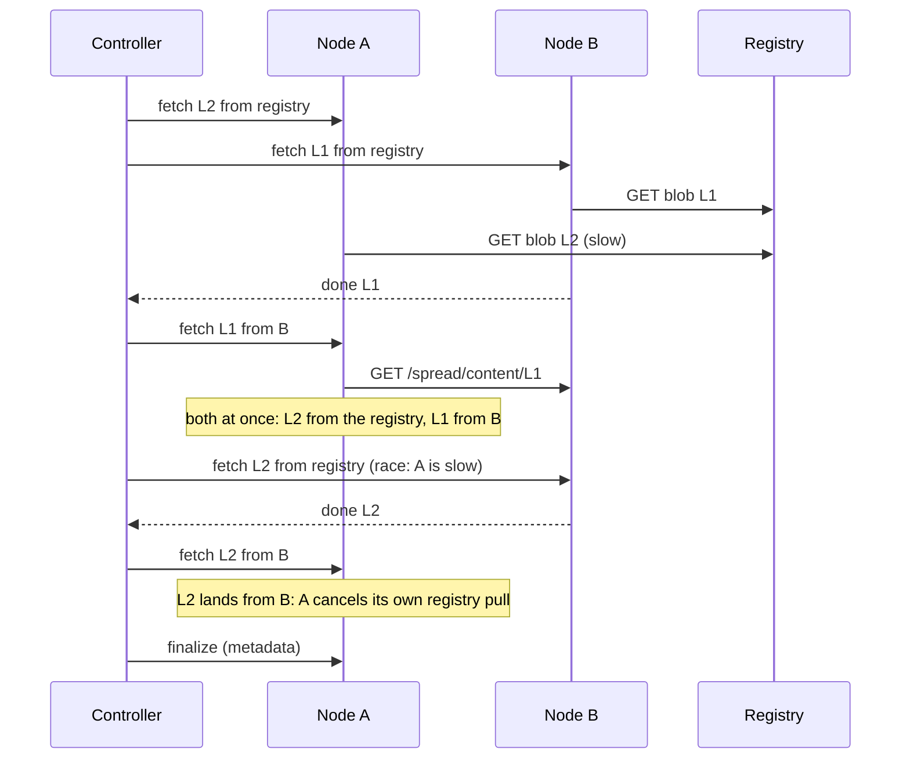

# Propagation

Once CI pushes an image, Angry Duck puts it on every eligible node, **blob by
blob**: every layer starts spreading between
nodes the moment any node has it, the registry serves each layer about
once, and no node waits for another to finish a whole image.

## How a push spreads

The controller reads the image's manifest and config from its registry (a
few KB, the same read [preheat](preheat.md) ranking uses), then keeps a
board of every layer: which nodes hold its blob, which are pulling it from
the registry, and which are receiving it from a peer.

The **blob is the unit**: a node receives any number of different blobs at
once, each at most once from the registry (north-south) and once from a
peer (east-west). Whenever a transfer ends, the controller hands out new
ones, about a second later, one new transfer per node per round until
nothing more fits, so the first node in line doesn't take every free
source:

- **East-west first.** A node lacking a layer that some node holds fetches
  it from that node. The rarest layer goes first (fewest holders), so new
  sources appear where they are scarcest. A source serves
  `PROPAGATE_PER_SOURCE` transfers at a time. There is no cluster-wide cap
  and no per-receiver cap: that per-source limit is the only one, so every
  holder's link is used and the transfers in flight grow with the holders.
  Blobs up to `SPREAD_EXPRESS_MAX_MB` (32) have a budget of their own on
  each source, so a 30 MB layer isn't stuck behind a 300 MB one.
- **The registry only for what nobody has.** A registry pull is ordered
  only for a layer no node holds yet, at most `SPREAD_MAX_REGISTRY_PULLS`
  pulls at once cluster-wide (default: `RANK_TOP_N`). Nobody
  pulling a layer comes first, the largest first.
- **No waiting on promises.** When every layer nobody holds is already
  being pulled, an idle node races the pull that has run longest, at most
  `SPREAD_RACE_PER_BLOB` (2) pulls per layer. A node with a bad route to the
  registry can't hold a heavy layer hostage.
- **Races end on the receiving node.** A node pulling a layer from the
  registry still gets it pushed from a peer as soon as a peer has it. When
  either copy lands, the worker cancels the other right away, by itself.
  Sometimes the registry is the slow path, sometimes the peer: the faster
  one wins.
- **Registering the image.** When a node holds every layer (its blob, or
  its unpacked snapshot), the controller sends it the image's metadata it
  read from the registry, checked against its digests on arrival, and the
  node registers and unpacks the image. Kubelet then finds it locally.
  Different images register side by side on a node; the same image one
  finalize at a time. How fast unpacking goes is up to the CPU and IO
  containerd gets.

Receivers are served in this order: nodes where a pod is already waiting
for the image, then the nodes that lack the fewest bytes.

## Streaming large blobs

A node still receiving a blob of `SPREAD_STREAM_MIN_MB` (32) or more is a
source for it too: a peer gets the bytes as they arrive there, instead of
waiting a whole transfer per hop. A 300 MB layer then reaches the second
node about when it reaches the first, not one transfer later.

- **The blob is still the unit.** Every receiver writes the whole blob and
  its containerd checks the digest at commit. The source reads the bytes
  from containerd's own ingest file, up to what containerd has written, so
  nothing is buffered or written twice.
- **Holders first.** A node that holds the blob is always preferred. A
  stream only goes to a node with no transfer of that blob yet, so the
  registry-versus-peer race works as before, and never around in a circle.
- **Chains.** A node streaming a blob streams it on too, so one blob can run
  down a line of nodes at once, each a fraction of a second behind the
  one before. `SPREAD_STREAM_MAX_DEPTH` caps the line; `0` (the default)
  caps it only by the number of nodes.
- **Joining, not racing.** A large blob whose registry pull is streamed on
  isn't raced from the registry: other nodes join the stream instead of
  splitting the registry's bandwidth, unless the pull is late (below).
  Blobs nobody streams are raced as before.
- **When the source stops.** If the source's own copy lands over its other
  path, the stream goes on from that copy. If its transfer fails, the stream
  is cut and the receiver reports it as the source's failure: the receiver
  isn't backed off, gets the blob elsewhere right away, and that source
  streams no more for the spread.
- **Slow-chain guard.** A chain is only as fast as its slowest node, so
  the controller watches for late transfers: running more than
  `SPREAD_SLOW_FACTOR` (2) times their expected time, which is the blob's
  size at the typical speed of their path, learned from finished
  transfers (30 s while none has finished yet, never before 5 s). It
  wakes up exactly when the next transfer would turn late.
  - *A late registry pull* that is streamed on is raced from the registry
    after all, by any node, those in its chain included. The pulling node
    also gets the blob pushed from the winner, and every stream from it
    moves to whichever of its copies is further ahead: the whole chain
    speeds up without starting over.
  - *A late stream* (a slow node somewhere up its chain) is offered a
    restart from a node that holds the blob, at most every 10 s, never
    from its own source, using one slot beyond `PROPAGATE_PER_SOURCE`.
    The receiver decides, because only it knows how far and how fast its
    stream is going: it restarts only if that should finish at least 25%
    sooner, judging its own link by its fastest finished transfer, or,
    without that history, keeping its stream while other transfers are
    coming in too (its link is then the limit, and a restart would only
    share it).
- *A second copy that wouldn't help:* a node already receiving a blob
  over one path is offered it over the other only if that should finish
  clearly sooner, judged the same way. A node at its own link's limit
  declines (asked again after 10 s) instead of splitting its link.
- **Mixed versions.** Workers say whether they stream in their reports. A
  worker without containerd's content store mounted, or older than 1.9.0,
  neither streams nor is streamed to.



## Blobs held until the image exists

Blobs arrive long before the image that references them, so each job's
blobs are held by a containerd lease on the node. The lease expires after
an hour on its own, so a crash or an abandoned job frees its blobs without
cleanup; a longer job moves them to a fresh lease halfway. Registering the
image ends the lease: from then on the image holds its blobs. A superseded
or expired job tells its nodes to drop theirs.

While a spread runs, the node's [mirror](mirror.md) already serves the
blobs it holds, so a pod scheduled there before the image is registered
pulls those layers locally.

## Fallbacks

- **No layer list.** If the image's manifest can't be read (no credentials
  for that registry, say), the push is seeded and propagated **whole**:
  `RANK_TOP_N` seeds pull the image, then nodes copy it from
  each other, each holder serving one node at a time so holders double each
  round. `SPREAD_ENABLED=false` or `RANK_BY_LAYERS=false` always works this
  way.
- **A layer the registry keeps failing on.** After three failed registry
  pulls of one layer, if some node has the whole image (holding that layer
  only as an unpacked snapshot, for instance), nodes lacking it get the whole
  image from there, [snapshots](transfers.md#snapshots) included. Without
  such a node, the registry is retried with backoff.

## Limits that apply

- Nodes matching `PROPAGATE_EXCLUDE_NODE_SUBSTRINGS` never receive, but do
  serve what they hold.
- Nodes above `PROPAGATE_MAX_UTILIZATION` get nothing new until
  [image cleanup](image-cleanup.md) brings them down. The controller logs
  each such node once per spread, with its disk. The spread counts as
  **complete** once every node with room has the image; it then stays open
  quietly, so a full node still receives it once cleanup makes room, until
  a newer tag supersedes it or `PROPAGATE_WINDOW_S` runs out.
- A node that fails backs off `SPREAD_RETRY_AFTER_S`, doubling up to
  `SPREAD_BACKOFF_MAX_S`.
- A transfer runs at most `SPREAD_TRANSFER_TIMEOUT_S`. A worker that never
  reports back has that transfer forgotten a minute later.
- A newer tag of the same repo supersedes the spread.

## Watching it

```bash
curl -s localhost:8080/status | jq '.spreads[] | {image, complete, done: (.done|length), skipped, nodes: [.nodes[] | {node, missing_layers, transfers}]}'
```

The dashboard's **Delivery** tab shows every running spread, what each node
still lacks, and every transfer moving right now. See
[Observability](observability.md#grafana-dashboard) for the metrics.

## Settings

`SPREAD_ENABLED`, `SPREAD_MAX_REGISTRY_PULLS`, `SPREAD_RACE_PER_BLOB`,
`SPREAD_RETRY_AFTER_S`, `SPREAD_BACKOFF_MAX_S`, `SPREAD_TRANSFER_TIMEOUT_S`,
`SPREAD_STREAM_ENABLED`, `SPREAD_STREAM_MIN_MB`, `SPREAD_STREAM_MAX_DEPTH`,
`SPREAD_EXPRESS_MAX_MB`, `SPREAD_SLOW_FACTOR`,
and from propagation `PROPAGATE_INTERVAL_S`, `PROPAGATE_WINDOW_S`,
`PROPAGATE_PER_SOURCE`,
`PROPAGATE_MAX_UTILIZATION`, `PROPAGATE_EXCLUDE_NODE_SUBSTRINGS`. The
whole-image fallback also uses `PROPAGATE_ENABLED` and
`PROPAGATE_SEED_TIMEOUT_*` and `PROPAGATE_MAX_CONCURRENT`. Spreading needs the shared token. See
[Configuration](configuration.md#spread).
