# Unpacking while blobs arrive

**Off by default.** Turning it on gives the worker power over every image on
its node. Read [What it costs](#what-it-costs) first.

With unpacking on arrival (`SPREAD_UNPACK_ENABLED`, on by default), a node
unpacks a layer once its blob has landed and the layer below is unpacked. A
large layer still costs its whole transfer, then its whole unpack. With
`SPREAD_UNPACK_STREAM_ENABLED=true`, the node unpacks the layer **while its
blob is still arriving**, so it is ready about when its last byte is.

```mermaid
gantt
    dateFormat X
    axisFormat %s
    section On arrival
    receive layer   :a1, 0, 5
    unpack layer    :a2, after a1, 5
    section While arriving
    receive layer   :b1, 0, 5
    unpack layer    :b2, 0, 6
```



## How it works

containerd can only unpack a committed blob. So the worker unpacks the layer
itself, with the same code containerd's own unpack runs for overlayfs
(containerd's `archive` package, the version the worker links):

1. When a transfer of a layer starts, the node queues the layer.
2. Once the layer below is unpacked (bottom up, as containerd unpacks), the
   worker asks containerd to prepare a snapshot on it, under the job's
   lease.
3. The worker reads the blob as it arrives, from the same ingest file peers
   stream from (whatever transfer of it runs on the node, then the committed
   blob), decompresses it, and writes the layer's files straight into the
   snapshot's upper directory: owners, modes, setuid bits, file
   capabilities, hardlinks, whiteouts and opaque directories, and a
   directory the layer only implies takes its owner and mode from the
   layers below, as with containerd.
4. **Nothing is trusted until it is checked.** The snapshot is committed
   under its chainID, through containerd, only when the bytes read hash to
   the blob's digest and size *and* the unpacked tar hashes to the diffID the
   chainID names. Otherwise it is removed.

Reading, decompressing and writing run on three goroutines with bounded
pipes between them (1.25 MiB in all), so decompressing, most of the CPU,
overlaps the rest. gzip uses klauspost's decoder, about a third faster than
Go's, which containerd uses.

When it can't help, nothing changes from unpacking on arrival:

- A layer whose blob has already landed when its turn comes is unpacked
  through containerd, as before.
- If unpacking while arriving fails for any reason (the transfer is cut, a
  check fails, a write is refused), the layer is unpacked through containerd
  once its blob lands (`stream_failed`).
- **zstd layers** are unpacked once they land, through containerd. A zstd
  decoder holds the frame's whole window (8 MiB with common settings): about
  13 MiB more for the worker while it runs, over the worker's memory budget.
- Snapshotters other than overlayfs, and overlayfs with `userxattr`
  (rootless), are left to containerd.

## What it costs

The worker gets, on top of what it holds without it:

| What | Why |
|---|---|
| `CAP_CHOWN`, `CAP_DAC_OVERRIDE`, `CAP_FOWNER`, `CAP_FSETID` | Files with their owners and modes, setuid bits included. |
| `CAP_MKNOD` | Whiteouts are character devices in overlayfs. |
| `CAP_SETFCAP` | File capabilities (`security.capability`). |
| `CAP_SYS_ADMIN` | Opaque directories are `trusted.overlay.opaque` xattrs. |
| `/var/lib/containerd/io.containerd.snapshotter.v1.overlayfs`, read-write, at the same path | The snapshots' directories, as containerd's mounts name them. |

That is **power over every image on the node**: a worker taken over could
change any layer of any image that any container starts from. Without it,
the worker holds no capabilities and everything privileged happens inside
containerd (see [Security](security.md)). Turn it on only if you trust the
worker image as you trust containerd itself.

What stays true:

- **containerd and kubelet keep working whatever happens to Angry Duck.**
  Until it is committed, the snapshot is an active one under the job's lease:
  nothing ever starts from it, and a worker that dies, is removed or
  uninstalled half way leaves it to the lease, which containerd's garbage
  collector clears. A wrong snapshot is never committed: see the checks
  above.
- **Memory.** About 3 MiB more for the worker while a layer unpacks (gzip),
  nothing when idle. The files written are page cache: the worker starts
  writeback for each large file once it is complete and drops it from cache
  once written, so it doesn't pile up charged to the worker's pod.
- **CPU.** The same work containerd would do (decompressing, hashing,
  writing), done by the worker instead, a bit sooner and a bit faster.

Known differences from containerd's own unpack: the worker runs the archive
code of containerd 1.7.36 (what it links), whatever containerd version the
node runs. The checks above guarantee the right bytes went in; how they are
written out is that version's code.

## Turning it on

Helm:

```yaml
worker:
  streamUnpack:
    enabled: true
```

That sets `SPREAD_UNPACK_STREAM_ENABLED=true` on the worker, adds the
capabilities above and mounts containerd's overlayfs snapshots. It also
needs `SPREAD_UNPACK_ENABLED` and `SPREAD_STREAM_ENABLED` (both on by
default) and containerd's content store mounted (as the chart does).

At startup the worker prepares a throwaway snapshot through containerd, finds
it at the same path, and creates in it what a layer can hold (an owned
setuid file, a whiteout, an opaque directory), then removes it. If any of
that fails, the feature stays off and the log says why:

```text
angryduck-worker[node-1]: WARNING: unpacking while blobs arrive is off: containerd's overlayfs snapshots aren't mounted at the same path here: ...
```

When on: `spread enabled: ... unpack_while_arriving=true`.

## How much faster

Measured on a 2-vCPU VM with containerd 1.7.27 (integration benchmarks in
`app/internal/worker/containerd_streamunpack_integration_test.go`, run with
`ANGRYDUCK_BENCH=1`). A 600 MiB layer already landed, unpacked:

| Layer | containerd (on arrival) | Worker (while arriving) |
|---|---|---|
| gzip | 5.8 s | 4.8 s |
| zstd | 2.8 s | 1.8 s |

A whole 3-layer image (80, 300 and 600 MiB unpacked, 469 MiB gzip), spread
to a node, two runs each:

| Link per blob | | All at finalize | On arrival (default) | While arriving |
|---|---|---|---|---|
| 100 MiB/s | first order to image registered | 12.5–12.6 s | 9.8–10.0 s | 8.9–9.1 s |
| | after the last byte landed | 9.5 s | 6.8–7.0 s | 5.9–6.0 s |
| 400 MiB/s | first order to image registered | 11.2–11.6 s | 9.8–10.6 s | 7.7–8.1 s |
| | after the last byte landed | 9.5–9.6 s | 7.5–8.5 s | 4.8–5.4 s |

On that machine the CPU, not the link, is the limit: decompressing gzip
takes longer than receiving it, and layers unpack one after another (each
onto the one below). The gain grows with faster links, faster CPUs and
larger top layers, and shrinks for images of many small layers. Measure on
your own nodes (`bench/`) before relying on it.

**The biggest single gain is outside Angry Duck: push zstd layers**
(BuildKit `--output type=image,compression=zstd,force-compression=true`).
They unpack about twice as fast as gzip, with or without this feature.

## With layers unpacked side by side

Where containerd 2.2+ lets a node [unpack layers side by
side](propagation.md#unpacking-layers-side-by-side), the two work together:
the lowest layer still arriving is unpacked here as its bytes come in, and
the layers that land meanwhile are unpacked by containerd side by side,
then all are committed bottom up. On a 2-vCPU VM the pair did no better
than either alone (both compete for the same CPU); on larger nodes, measure.

## Metrics

`angryduck_worker_spread_unpacks_total{result}` counts, per node:
`streamed` (unpacked while the blob arrived), `stream_failed` (that failed,
unpacked once it landed instead), next to `applied`, `present` and
`failed`. The *Layers Unpacked on Arrival* panels show them.
