# Unpacking while blobs arrive

**Off by default.** Turning it on gives the worker power over every image on
its node. Read [What it costs](#what-it-costs) first.

With unpacking on arrival (`SPREAD_UNPACK_ENABLED`, on by default), a node
unpacks a layer once its blob has landed and the layer below is unpacked. A
large layer still costs its whole transfer, then its whole unpack. With
`SPREAD_UNPACK_STREAM_ENABLED=true`, the node unpacks the layer **while its
blob is still arriving**, so it is ready about when its last byte is.

```mermaid
gantt
    dateFormat X
    axisFormat %s
    section On arrival
    receive layer   :a1, 0, 5
    unpack layer    :a2, after a1, 5
    section While arriving
    receive layer   :b1, 0, 5
    unpack layer    :b2, 0, 6
```



## How it works

containerd can only unpack a committed blob. So the worker unpacks the layer
itself, with the same code containerd's own unpack runs for overlayfs
(containerd's `archive` package, the version the worker links):

1. When a transfer of a layer starts, the layer starts unpacking, whatever
   the layers below are doing: **every layer of an image unpacks at the same
   time as it arrives**, up to `SPREAD_UNPACK_PARALLEL_MAX` layers at once
   on the node.
2. If the layer below is already unpacked, the worker asks containerd to
   prepare a snapshot on it, under the job's lease. If it isn't yet, the
   layer goes into a snapshot of its own, with nothing below, so it doesn't
   wait.
3. The worker reads the blob as it arrives, from the same ingest file peers
   stream from (whatever transfer of it runs on the node, then the committed
   blob), decompresses it, and writes the layer's files straight into the
   snapshot's upper directory: owners, modes, setuid bits, file
   capabilities, hardlinks, whiteouts and opaque directories.
4. A layer unpacked on its own is **attached** once the layer below is
   committed, bottom up: a snapshot is prepared on the layer below, the
   files are moved into it (renames on the same disk: instant, whatever
   their size), and the directories the layer only implies (an entry inside
   them, none for themselves, noted as the archive went by) take the owner,
   mode and xattrs of the same path in the layers below, symlinks followed,
   exactly as containerd's unpack onto them would have. Then it is
   committed under its chainID and the temporary snapshot removed.
5. **Nothing is trusted until it is checked.** A snapshot is committed only
   when the bytes read are the blob's size *and* the unpacked tar hashes to
   the diffID the chainID names, which proves the content is the layer's.
   The blob's own digest is checked by containerd when it commits the blob;
   the worker doesn't hash it a second time. Otherwise the snapshot is
   removed.

An integration test unpacks a 3-layer image whose layers arrive top first,
with every kind of implied directory (owned with xattrs, missing below,
deleted below, a symlink below, opaque), and compares every file with
containerd's own unpack of the same image.

Reading, decompressing and writing run on three goroutines with bounded
pipes between them (1.25 MiB in all), so decompressing, most of the CPU,
overlaps the rest. gzip uses klauspost's decoder, about a third faster than
Go's, which containerd uses.

When it can't help, nothing changes from unpacking on arrival:

- A layer whose blob has already landed is unpacked through containerd when
  the layer below is there (its files are then charged to containerd, not
  the worker). Only if the layer below isn't there yet does the worker
  unpack it on its own from the landed blob, rather than leave it waiting.
- If unpacking while arriving fails for any reason (the transfer is cut, a
  check fails, a write is refused), the layer is unpacked through containerd
  once its blob lands (`stream_failed`).
- **zstd layers** are unpacked once they land, through containerd. A zstd
  decoder holds the frame's whole window (8 MiB with common settings): about
  13 MiB more for the worker while it runs, over the worker's memory budget.
- Snapshotters other than overlayfs, and overlayfs with `userxattr`
  (rootless), are left to containerd.

## What it costs

The worker gets, on top of what it holds without it:

| What | Why |
|---|---|
| `CAP_CHOWN`, `CAP_DAC_OVERRIDE`, `CAP_FOWNER`, `CAP_FSETID` | Files with their owners and modes, setuid bits included. |
| `CAP_MKNOD` | Whiteouts are character devices in overlayfs. |
| `CAP_SETFCAP` | File capabilities (`security.capability`). |
| `CAP_SYS_ADMIN` | Opaque directories are `trusted.overlay.opaque` xattrs. |
| `/var/lib/containerd/io.containerd.snapshotter.v1.overlayfs`, read-write, at the same path | The snapshots' directories, as containerd's mounts name them. |

That is **power over every image on the node**: a worker taken over could
change any layer of any image that any container starts from. Without it,
the worker holds no capabilities and everything privileged happens inside
containerd (see [Security](security.md)). Turn it on only if you trust the
worker image as you trust containerd itself.

What stays true:

- **containerd and kubelet keep working whatever happens to Angry Duck.**
  Until it is committed, the snapshot is an active one under the job's lease:
  nothing ever starts from it, and a worker that dies, is removed or
  uninstalled half way leaves it to the lease, which containerd's garbage
  collector clears. A wrong snapshot is never committed: see the checks
  above.
- **Memory.** About 3 MiB more for the worker while a layer unpacks (gzip),
  nothing when idle. The files written are page cache: the worker starts
  writeback for each file once it is complete and, a few files later (at
  most 64 files or 8 MiB in flight), hands it to a goroutine that waits for
  that writeback to finish and then drops it from cache: the kernel won't
  drop pages still being written. The unpack never waits on the disk; if
  that goroutine is behind, the file is dropped at once instead. So the
  page cache doesn't pile up charged to the worker's pod. The
  kernel's records of those files (inodes, directory entries,
  `slab_reclaimable`) would stay charged to the worker until the image is
  removed or the node needs memory, so a few seconds after the last unpack
  ends (or 30 s after it, if requests keep coming), and never while a
  request, transfer or unpack is moving data, the worker writes to its
  cgroup's `memory.reclaim` and the kernel
  takes them back (with any page cache left): on stg, `slab_reclaimable`
  40.9 to 2.2 MB after a 20,000-file layer. The records of the last files
  can't be taken back until the kernel has written their metadata out
  (`dirty_expire_centisecs` + `dirty_writeback_centisecs`, 35 s by
  default), so when a hand-back frees less than half, it runs once more
  after that window. Each logs `memlimit: reclaimed …` with what it freed. For that it mounts its own
  cgroup at `/run/angryduck/cgroup` (a private cgroup namespace shows only
  its own), which needs `CAP_SYS_ADMIN` (already given) and an AppArmor
  profile that allows mount: the chart sets `appArmorProfile: Unconfined`
  with stream unpack on (Kubernetes 1.30+). Without it the worker logs a
  warning and the records stay as before.
- **CPU.** The same work containerd would do (decompressing, hashing,
  writing), done by the worker instead, a bit sooner and a bit faster.

Known differences from containerd's own unpack: the worker runs the archive
code of containerd 1.7.36 (what it links), whatever containerd version the
node runs. The checks above guarantee the right bytes went in; how they are
written out is that version's code.

## Turning it on

Helm:

```yaml
worker:
  streamUnpack:
    enabled: true
```

That sets `SPREAD_UNPACK_STREAM_ENABLED=true` on the worker, adds the
capabilities above and mounts containerd's overlayfs snapshots. It also
needs `SPREAD_UNPACK_ENABLED` and `SPREAD_STREAM_ENABLED` (both on by
default) and containerd's content store mounted (as the chart does).

At startup the worker prepares a throwaway snapshot through containerd, finds
it at the same path, and creates in it what a layer can hold (an owned
setuid file, a whiteout, an opaque directory), then removes it. If any of
that fails, the feature stays off and the log says why:

```text
angryduck-worker[node-1]: WARNING: unpacking while blobs arrive is off: containerd's overlayfs snapshots aren't mounted at the same path here: ...
```

When on: `spread enabled: ... unpack_while_arriving=true`.

## How much faster

Since 1.14.3, on a 2-vCPU VM with containerd 1.7.27, the 3-layer image
below (469 MiB gzip), spread to a node, two runs each, unpacking while
arriving:

| Link per blob | | 1.14.2 | 1.14.3 |
|---|---|---|---|
| 100 MiB/s | first order to image registered | 7.75–8.13 s | 6.39–6.97 s |
| | after the last byte landed | 4.69–5.05 s | 1.32–1.56 s |
| 400 MiB/s | first order to image registered | 7.62–7.68 s | 6.45–6.55 s |
| | after the last byte landed | 5.12–5.37 s | 0.97–1.45 s |

The earlier numbers below are from before 1.14.3, when only one layer at a
time could unpack while it arrived.

Measured on a 2-vCPU VM with containerd 1.7.27 (integration benchmarks in
`app/internal/worker/containerd_streamunpack_integration_test.go`, run with
`ANGRYDUCK_BENCH=1`). A 600 MiB layer already landed, unpacked:

| Layer | containerd (on arrival) | Worker (while arriving) |
|---|---|---|
| gzip | 5.8 s | 4.8 s |
| zstd | 2.8 s | 1.8 s |

A whole 3-layer image (80, 300 and 600 MiB unpacked, 469 MiB gzip), spread
to a node, two runs each:

| Link per blob | | All at finalize | On arrival (default) | While arriving |
|---|---|---|---|---|
| 100 MiB/s | first order to image registered | 12.5–12.6 s | 9.8–10.0 s | 8.9–9.1 s |
| | after the last byte landed | 9.5 s | 6.8–7.0 s | 5.9–6.0 s |
| 400 MiB/s | first order to image registered | 11.2–11.6 s | 9.8–10.6 s | 7.7–8.1 s |
| | after the last byte landed | 9.5–9.6 s | 7.5–8.5 s | 4.8–5.4 s |

On that machine the CPU, not the link, is the limit: decompressing gzip
takes longer than receiving it, and layers unpack one after another (each
onto the one below). The gain grows with faster links, faster CPUs and
larger top layers, and shrinks for images of many small layers. Measure on
your own nodes (`bench/`) before relying on it.

### On a cluster, before 1.14.3

The bench (`bench/`) on a 21-node cluster with containerd 1.7, the rollout
started together with the preheat (`PREHEAT_LEAD=0`), workers only:

| Image | | Off | On |
|---|---|---|---|
| 1 layer, 20,000 files of 8 KiB (166 MB) | rollout to all pods Ready | 34 s (3 runs) | 30 s (3 runs) |
| | worker working set after each run | 10.0, 10.6, 10.8 MiB | 46.9, 68.5, 95.2 MiB |
| 8 layers of 256 MiB (2 GB) | rollout to all pods Ready | 105 s | 111 s |
| | worker CPU, all workers | 657 s | 1046 s |

Two things showed up:

- **Kernel memory per file.** Each file the worker creates leaves the
  kernel's record of it (`slab_reclaimable`) charged to the worker, about
  1.6 KiB per file, until the image is removed or the container nears its
  limit. With unpacking left to containerd, the same memory is charged to
  containerd instead. 1.14.3 hands it back after each unpack
  (`memory.reclaim`). Page cache from the files written was also kept for
  small files; 1.14.3 drops it for every file.
- **Multi-layer images barely streamed.** Before 1.14.3 a layer could only
  stream once the layer below was unpacked, one after another, so on the
  8-layer image only 10 of 144 layer unpacks happened while their blobs
  arrived. 1.14.3 streams every layer as it arrives (see [How it
  works](#how-it-works)).

The CPU column counts only the workers: with the feature off, containerd
does the decompressing and writing, out of sight. The bench now samples
containerd too (`RES_CONTAINERD`), and 1.14.3's numbers replace these.

**The biggest single gain is outside Angry Duck: push zstd layers**
(BuildKit `--output type=image,compression=zstd,force-compression=true`).
They unpack about twice as fast as gzip, with or without this feature.

## With layers unpacked side by side

Where containerd 2.2+ lets a node [unpack layers side by
side](propagation.md#unpacking-layers-side-by-side), the two work together:
the lowest layer still arriving is unpacked here as its bytes come in, and
the layers that land meanwhile are unpacked by containerd side by side,
then all are committed bottom up. On a 2-vCPU VM the pair did no better
than either alone (both compete for the same CPU); on larger nodes, measure.

## Metrics

`angryduck_worker_spread_unpacks_total{result}` counts, per node:
`streamed` (unpacked while the blob arrived), `stream_failed` (that failed,
unpacked once it landed instead), next to `applied`, `present` and
`failed`. The *Layers Unpacked on Arrival* panels show them.
